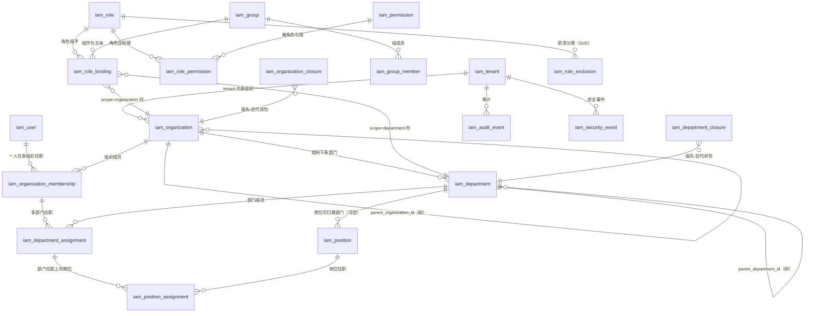

# IAM 组织 / 部门 / 任职 / 角色 / 岗位 数据模型与行业规范对照

- 依据：`sdkwork-iam/database/ddl/baseline/postgres/0001_iam_baseline.sql`（含折叠迁移 0008–0051）
- 已落地迁移：0049（部门排序、唯一主部门、角色数据范围/有效期）、0050（部门/任职版本号）、0051（花名册索引）
- 目的：给评审者一张完整的"谁挂谁"的关系图 + 表结构清单 + 行业规范差距评估

## 1. 概念关系（一张图）



文本版主干：

```
Tenant ─┬─ Organization(tree: parent + closure + path + sort_order)
        │        └─ Department(tree: parent + closure + path + sort_order + version)
        │                     └─ Position(目录, department? 可空)
        └─ OrganizationMembership(人×组织, kind, employee_no, joined/left)
                     └─ DepartmentAssignment(人×部门, 多对多, 唯一主部门, 有效期, version)
                                 └─ PositionAssignment(任职×岗位, 唯一主岗位, 有效期)
User ── Membership（SSO/身份在 iam_user，任职在 membership）
Role ── RolePermission ── Permission（全局权限目录）
Role ── RoleBinding（principal: user / membership / group / service_account；
                      scope: tenant|organization|department；
                      data_scope: scope|self|department|department_and_children|organization|tenant；
                      effect: allow|deny；有效期）
Group ── GroupMember；RoleExclusion（SoD）
Audit/SecurityEvent 记录变更与风险
```

## 2. 表结构清单（按职责分组）

> 仅列关键列；完整 DDL 以 baseline 为准。`tenant_id` 存在于所有租户表，`organization_id`（默认 `'0'`）存在于组织域表。

### 2.1 组织域

| 表 | 主键/唯一 | 关键列 | 说明 |
| --- | --- | --- | --- |
| `iam_organization` | PK `id`；UQ `(tenant_id, code)` | `parent_organization_id`, `path`, `sort_order`, `organization_kind`, `status`, `contact_*` | 组织树；以 closure 表维护祖先关系 |
| `iam_organization_closure` | UQ `(tenant, ancestor, descendant)` | `depth` | 组织树闭包 |
| `iam_department` | PK `id`；UQ `(tenant, org, code)` | `parent_department_id`, `path`, `sort_order`, `department_kind`, `cost_center_code`, `manager_membership_id`, `version` | 部门树；`path` 与 closure 在换父/改编码时同事务重写 |
| `iam_department_closure` | UQ `(tenant, org, ancestor, descendant)` | `depth` | 部门树闭包（数据范围"含下级"依赖它） |

### 2.2 人员与任职

| 表 | 主键/唯一 | 关键列 | 说明 |
| --- | --- | --- | --- |
| `iam_user` | PK `id`；UQ `(tenant, username)`；`(tenant,email/phone)` 部分唯一 | `display_name`, `email`, `phone`, `status`, `is_deleted` | 身份主体（不含组织归属） |
| `iam_organization_membership` | PK `id`；UQ `(tenant, org, user, membership_kind)` | `employee_no`, `display_name`, `is_primary`, `joined_at`, `left_at`, `status` | 任职关系（一人可属多组织） |
| `iam_department_assignment` | PK `id`；UQ `(tenant, org, membership, department, assignment_kind)`；**部分唯一：活跃主部门唯一** | `assignment_kind`, `is_primary`, `effective_from/to`, `version`, `status` | 一人多部门；0049 建立唯一主部门约束 |
| `iam_position` | PK `id`；UQ `(tenant, org, code)` | `department_id?`, `position_kind`, `rank_level`, `status` | 岗位目录 |
| `iam_position_assignment` | PK `id`；UQ `(tenant, org, department_assignment, position)`；**部分唯一：活跃主岗位唯一** | `user_id`, `is_primary`, `effective_from/to`, `status` | 岗位挂在"部门任职"上，实现"研发部-后端工程师 + 架构组-委员"并存 |

### 2.3 授权域

| 表 | 主键/唯一 | 关键列 | 说明 |
| --- | --- | --- | --- |
| `iam_role` | PK `id`；UQ `(tenant, code)` | `role_class`, `module_id`, `surface`, `assignable`, `standard`, `label_i18n` | 角色（权限包） |
| `iam_permission` | PK `id`；UQ `code` | `resource`, `action`, `module_id`, `domain`, `status` | 全局权限目录（跨租户只读） |
| `iam_role_permission` | UQ `(tenant, role, permission)` | — | 角色-权限 |
| `iam_role_binding` | PK `id`；UQ `(tenant, role, principal_kind, principal_id, scope_kind, scope_id)` | `effect`, `data_scope_kind`, `effective_from/to`, `condition_json`, `organization_id` | 授予；scope=tenant/org/department；数据范围与有效期 0049 引入 |
| `iam_role_exclusion` | — | `role_code`, `excludes_role_code` | 职责分离（SoD） |
| `iam_policy` | UQ `(tenant, code)` | `policy_json` | 策略 JSON（目前仅 OAuth 绑定策略消费） |
| `iam_group` / `iam_group_member` | — | `group_kind`；成员主体 | 主体集合，可被角色绑定引用 |

### 2.4 审计与安全

| 表 | 说明 |
| --- | --- |
| `iam_audit_event` | 目录/授权变更审计（`record_backend_mutation_audit_tx` 写入） |
| `iam_security_event` | 登录/风险类事件 |

## 3. 关系规则（业务不变量）

1. 一个 membership 在同一组织内**最多一条活跃主部门**（部分唯一索引，0049）。
2. 一个 department_assignment 最多一条活跃主岗位（部分唯一索引，0049）。
3. 部门换父/改编码在**同一事务**内重写 `path` 与 closure，并校验"不能成为自身或后代"。
4. 部门/任职带 `version`，移动与改部门携带 `expectedVersion`，冲突返回 409（0050）。
5. 删除部门前校验：无活跃子部门、无活跃成员任职（409）。
6. 角色绑定解析：`deny` 优先于 `allow`；超出有效期的绑定不授予；`department` 作用域要求调用者在目标部门有活跃任职。
7. 数据范围按"最宽 allow"解析：`tenant > organization > department_and_children > department > self`；遗留 `scope` 继承绑定自身 scope；未知值 fail-closed。
8. 人员/部门/岗位的退役均为 `status` 软删除；任职/岗位任职用 `effective_to` 表达结束。

## 4. 与行业规范对照

参考模型：SCIM 2.0（User/Group/EnterpriseUser）、Workday（Organization/Job/Position/Job Requisition）、Okta/Entra（Role/Assignment/Scope）、飞书/钉钉（部门树 + 主部门/兼职 + 岗位 + 角色）。

| 能力 | 本模型 | 行业常见 | 评价 |
| --- | --- | --- | --- |
| 组织→部门多级树 | adjacency + closure + materialized path + sort_order | 同 | ✅ 完整（closure 支持"含下级"查询） |
| 一人多组织、一人多部门 | membership + department_assignment（多对多） | 同 | ✅ |
| 主部门/兼岗 | 部分唯一索引保证唯一主部门 | 同 | ✅ |
| 岗位模型 | 岗位目录 + 按部门任职的岗位（一人多岗） | Job（岗位类别）与 Position（编制/职位）通常分离 | ⚠️ 缺"编制/headcount/职位"层，`rank_level` 仅整数等级 |
| 角色 RBAC | role → permission，绑定 principal + scope + effect | 同 | ✅（无"直授权限"，规范做法） |
| 数据范围 | binding.data_scope_kind，5 档，查询层消费 | 同（row-level scope） | ✅ 设计到位；缺真库用例证据 |
| 时效授权 | effective_from/to，解析 fail-closed | PIM/临时授权常见 | ✅ 基础具备；缺"到期自动清理/审批流" |
| 职责分离 SoD | `iam_role_exclusion` | 同 | ✅ 基础具备；缺冲突检测的"申请时阻断"闭环（仅创建时校验） |
| 条件授权 ABAC | `condition_json` 列存在但未求值 | 同 | ⚠️ 死字段，需实现或移除 |
| 组织层级元数据 | `organization_kind`/`tenant_boundary_kind`/`data_boundary_kind`/`cost_center_code` | 法人/成本中心/数据边界 | ⚠️ 成本中心仅字符串，无成本中心维度表 |
| 审批/工单 | 无 | 入职/调岗/授权审批 | ❌ 缺 |
| 报告关系（汇报线） | 仅部门 `manager_membership_id` | person→person manager 链 | ❌ 缺人员汇报关系 |
| 访问评审/权限回收 | 无 | access certification / recertification | ❌ 缺 |
| SCIM/HR 同步 | 无 | SCIM 2.0、HRIS 同步 | ❌ 缺 |
| 审计 | audit_event / security_event + 变更审计 | 同 | ✅ 基础具备；缺字段级前后值 |
| 多语言命名 | `label_i18n`/localized seeds | 同 | ✅ |

## 5. 结论与建议

**结论**：组织/部门树、任职关系、多部门与主部门、岗位任职、RBAC + 数据范围 + 时效授权这几块**符合行业主流模型**，关键不变量已落库（唯一主部门/主岗位、版本号、闭包）。差距集中在"企业级治理"而非"核心模型"：

1. **岗位模型分层**（高优）：补 `position`（编制，含 headcount、reporting_to_position）或明确文档化为"Job catalog"，避免与 Workday 语义混淆。
2. **ABAC 或删除死字段**（高优）：`condition_json` 要么实现求值，要么在契约中移除，避免安全承诺落空。
3. **访问评审与到期回收**（中）：为 `effective_to` 增加到期任务与评审流；SoD 从"创建时校验"扩展到"授权前冲突预检"。
4. **SCIM/HR 同步**（中，商业化必需）：企业客户通常要求 SCIM 或 HRIS 对接。
5. **成本中心/法人维度**（中）：把 `cost_center_code` 提升为维度表，便于财务与数据边界联动。
6. **字段级审计**（中）：当前审计记录"改了哪些字段"，不记录前值/后值，合规审计常要求 diff。

> 说明：本对照基于 baseline DDL 与 0049–0051 迁移，以及本会话已落地的接口/解析逻辑；未在真实 PostgreSQL 上做逐表 `\d` 复核，`iam_group`/`iam_service_account`/审计表的全部列未逐一展开。
