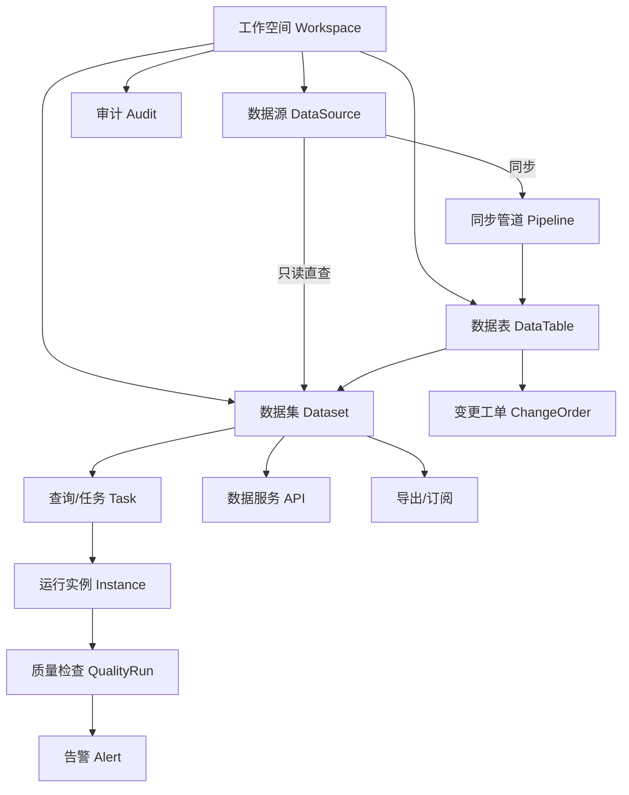
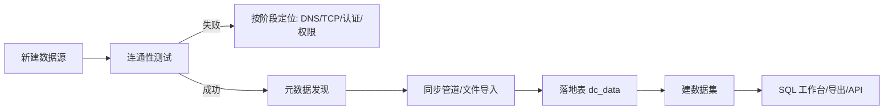
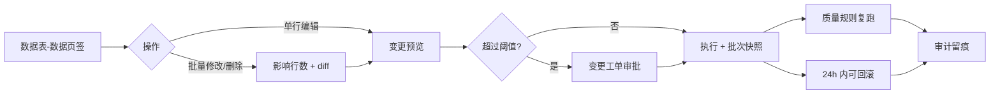
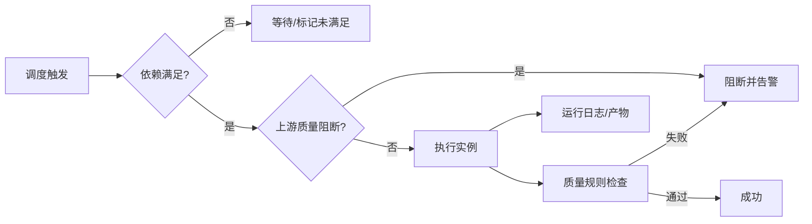

# Admin 数据中心（Data Center）——独立数据中台产品与功能设计方案

Status: draft
Owner: cloudrouter-frontend / cloudrouter-data
Application: sdkwork-cloudrouter
Updated: 2026-11-16

> 需求：在 admin 中新增「数据中心」，并在 admin header 中新增入口；数据中心用于日常数据维护，对齐行业专业设计与解决方案，形成完整、可商业化交付的数据中心体系。
>
> 本轮已确认的三个前提：
> 1. 形态 = **独立数据中台**（数据接入 → 建模 → 开发 → 质量 → 服务 → 运维），不是对现有页面的改造或聚合；
> 2. 数据来源 = **平台自有库/服务 + 外部数据源 + 用户上传文件**（三类全要）；
> 3. 后端 = **允许新建独立服务与独立数据表**。
>
> 本轮交付：仅产品与功能设计报告，**未改任何代码**。确认后按 §11 分期实施。

---

## 0. 变更边界（先立红线）

### 0.1 允许做（全部为「新增」）

| 类别 | 新增内容 |
| --- | --- |
| 前端 | 新增包 `sdkwork-cloudrouter-pc-admin-data`；新增 i18n 资源包与键位；新增 admin 路由贡献 |
| 注册 | 模块目录追加 1 条 `dataCenter`；侧边栏追加 1 组菜单；权限 hint 追加 1 条；站点设置图标表追加 1 个映射 |
| 后端 | 新增 crate（service / repository / routes / worker）；新增 `/backend/v3/api/datacenter/*` 接口；新增 `datacenter` / `dc_data` schema 与元数据表；装配层挂载新路由与新 worker |
| 权限 | IAM manifest 追加数据中台权限码（catalogVersion 递增，只增不改） |
| 文档 | 本文；后续实施计划与验收记录 |

### 0.2 明确不做（零改动清单）

| ❌ 不做 | 说明 |
| --- | --- |
| 迁移 `/admin/record`、`/admin/request-log`、`/admin/analytics` | 现有页面原样保留；数据中心不接管、不重定向、不复用其页面 |
| 修改任何现有模块的菜单、路由、权限语义、页面行为 | 包括首页「数据管理」分组、支付中心对账、存储中心用量 |
| 修改现有 102 条 backend-api 路径的任何一条 | 只**新增** `datacenter` 子路径，不改既有 operation |
| 修改现有生成 SDK 的既有模型与客户端方法 | 只随契约新增而追加命名空间 |
| 改 `docs/legal/TIER_MATRIX.md`、`docs/commercial/PRICING.md` | 商业化分层只在本文设计，落地时单独立项评审 |
| 让数据中心直接读写现有业务表 | 平台库只能以**只读数据源**方式接入（只读账号 + 只读副本优先） |

### 0.3 与现有模块的关系（只做邻居，不做替代）

| 现有模块 | 数据中心的立场 |
| --- | --- |
| 首页 → 数据管理（调用记录/请求日志/分析） | 不重叠：那边是「业务明细与既定看板」，这里是「数据中台能力」。若需这些数据，由运营在数据中心把平台库接成只读数据源后自助建模 |
| 支付中心对账 / 存储中心用量 | 不接管：业务动作留在原中心；数据中心只在需要时把对应对账数据接入成表 |
| 运维管理（监控/告警/服务节点） | 不重叠：运维管理管平台运行态；数据中心管数据资产与数据作业 |

---

## 1. 产品定位

### 1.1 一句话定义

> **数据中心 = 平台内置的独立数据中台**：把平台自有数据、外部数据库、上传文件统一接入，落地成可治理的数据表与数据集，提供 SQL 开发、调度、质量、资产目录、数据服务与审计，让「日常数据维护」从连库写脚本变成产品内闭环。

### 1.2 六条产品原则

| # | 原则 | 含义 |
| --- | --- | --- |
| 1 | 接入即隔离 | 每个外部连接有独立凭据、出网策略、连通性测试；凭据只写不读 |
| 2 | 落地才可治理 | 需要维护的数据必须落地到 `dc_data` 自有 schema；外部源默认只读直查 |
| 3 | 一切可回滚 | DDL/DML 走变更工单；批量维护有快照与反向补偿 |
| 4 | 调度即产品 | 每个同步/质量/服务任务都有实例、日志、重跑、补数 |
| 5 | 资产可发现 | 表、字段、指标、血缘、负责人、敏感级统一可搜 |
| 6 | 交付受控 | 导出/API/订阅都有配额、脱敏、水印、到期与审计 |

### 1.3 非目标（本期不做，避免范围蔓延）

- 不做机器学习/特征平台；不做实时流计算（CDC 仅列 P2）；不做跨云数据湖；不做外部数据市场；不做自由 BI 大屏拖拽（看板为 P2 的受限形态）。

---

## 2. 能力完备性：行业对标矩阵

对标行业系统，逐项确认「数据中心该有的是不是都有」。阶段含义：P0 首发、P1 增强、P2 商业化。

| # | 能力域 | 关键能力 | 对标 | 阶段 |
| --- | --- | --- | --- | --- |
| C1 | 数据接入 | 连接器、凭据管理、连通性测试、元数据自动发现、表结构变更检测 | DataWorks 数据集成、Airbyte、Fivetran、FineDataLink | P0 |
| C2 | 数据集成 | 全量/增量同步、字段映射、过滤条件、脏数据隔离、失败重试、限流 | DataWorks、DataLeap、Airbyte | P0 全量 / P1 增量 |
| C3 | 文件接入 | CSV/XLSX 上传、字段映射、校验报告、错误行导出 | DMS、FineDataLink | P0 |
| C4 | 数据存储 | 落地表、字段类型、主键、索引、分区、存储用量、生命周期 | Snowflake、BigQuery | P0 |
| C5 | 数据建模 | 数据表、视图、数据集（业务视图）、字段语义、版本 | dbt、DataWorks 建模 | P0 表 / P1 数据集版本 |
| C6 | 数据开发 | SQL 工作台（高亮/补全/解释计划/结果分页）、脚本任务、参数、版本 | DataWorks 数据开发、DMS | P0 只读查询 / P1 脚本任务 |
| C7 | 调度运维 | Cron、依赖、并发控制、超时、实例、重跑、补数据、告警 | DataWorks 运维中心、Airflow | P1 |
| C8 | 数据质量 | 规则模板（非空/唯一/枚举/范围/一致性/新鲜度）、采样、阻断/告警、报告趋势 | DataWorks 质量、Great Expectations | P1 |
| C9 | 数据资产 | 目录、数据字典、血缘（表→表→服务）、负责人、标签、搜索 | DataHub、Atlas、DataWorks 数据地图 | P1 |
| C10 | 数据服务 | 数据集发布 REST API、Key、限流、配额、在线文档 | DataWorks 数据服务、Superset embedded | P2 |
| C11 | 数据交付 | 受控导出（水印/到期/审批）、订阅推送（邮件/Webhook） | Metabase 订阅、Stripe Sigma | P0 导出 / P2 订阅 |
| C12 | 数据分析 | 保存查询、图表、看板 | Metabase、Superset | P2 |
| C13 | 安全治理 | 工作空间隔离、RBAC、行级/列级、脱敏、审计、水印 | Lake Formation、DMS 安全 | P0 审计 / P1 行列级 |
| C14 | 变更管理 | DDL/DML 变更工单、审批、执行、回滚 | DMS 数据变更工单 | P1 |
| C15 | 商业化 | 版本分层、配额、计量、用量账单 | Snowflake/BigQuery 计费 | P2 |
| C16 | 平台自身 | 工作空间、成员、配额、连接器管理、系统设置 | 各平台均有 | P0 |

---

## 3. 领域模型



| 概念 | 定义 | 关键约束 |
| --- | --- | --- |
| 工作空间 | 隔离单元，对应租户/团队 | 所有资源必须归属一个工作空间 |
| 数据源 | 外部/平台库连接配置 | 凭据加密、只写不读、必须连通性测试通过才可引用 |
| 数据表 | 落地表（`dc_data`）或外部表（只读）或视图 | 落地表才有主键与数据维护能力 |
| 数据集 | 面向业务的数据视图（字段白名单 + 过滤 + 行级策略） | 数据服务、导出、看板只认数据集 |
| 同步管道 | 源 → 落地表的字段映射与调度 | 每次运行生成实例，脏数据进隔离表 |
| 任务 | SQL 脚本 + 参数 + 调度表达式 | 版本化，发布后才可被调度 |
| 实例 | 一次任务/管道的运行 | 可重跑、可补数、有日志、有产物 |
| 质量规则 | 挂在表/数据集上的校验 | 分阻断级与提醒级 |
| 变更工单 | DDL/DML 审批执行 | 必须有影响预览与回滚方案 |
| 数据服务 | 数据集对外 REST 能力 | 有 Key、限流、配额、文档 |

---

## 4. 信息架构

### 4.1 Header 入口

| 项 | 决策 |
| --- | --- |
| 模块 ID | `dataCenter` |
| 文案 | 英文 `Data Center` / 中文 `数据中心` |
| 图标 | `Table2`（与「模型管理」`Database`、「支付对账」`DatabaseZap` 区分） |
| 落地页 | `/admin/data/overview` |
| 路径前缀 | `/admin/data` |
| 位置 | **catalog 索引 1（首页之后、应用中心之前）** |

位置理由与注意：

- admin header 是模块级导航，宽度不足会把靠后模块折叠进「更多」（`AdminHeader.tsx`，折叠按钮固定 108px）；放第 2 位保证日常入口不被折叠。
- 既有约束：模块 ID 在两个平面（shell 联合类型 + commons 目录），且有测试断言两者顺序一致；本次为**同位置追加**，不改任何既有条目。
- 存量部署中，模块开关存储会把新模块追加到末尾（`normalizeAdminModuleSettings` 的既有语义），发布说明需提示运营到 `/admin/site` 调整顺序。

### 4.2 侧边栏信息架构（8 组 / 24 页）

> 硬规则：未交付的页面不进菜单；不留空壳页面。

| 分组 | 页面 | 路由 | 核心能力 | 阶段 |
| --- | --- | --- | --- | --- |
| 总览 | 数据中心概览 | `/admin/data/overview` | 资源总览、任务成功率、数据量、质量、待办 | P0 |
| 数据接入 | 数据源 | `/admin/data/sources` | 新建/测试/编辑连接、凭据、元数据发现 | P0 |
| | 数据源详情 | `/admin/data/sources/:sourceId` | 库表浏览、字段预览、连通性历史 | P0 |
| | 同步管道 | `/admin/data/pipelines` | 全量/增量同步、字段映射、过滤、调度 | P0/P1 |
| | 文件导入 | `/admin/data/imports` | CSV/XLSX 上传、映射、校验、错误行 | P0 |
| 数据资产 | 数据表 | `/admin/data/tables` | 表清单、DDL、索引、分区、存储量 | P0 |
| | 数据表详情 | `/admin/data/tables/:tableKey` | 结构与数据双页签、明细维护、DDL 申请 | P0 |
| | 数据集 | `/admin/data/datasets` | 业务视图、字段白名单、行级策略 | P0 |
| | 数据字典 | `/admin/data/dictionary` | 字段语义、枚举值、负责人 | P1 |
| | 血缘分析 | `/admin/data/lineage` | 源→表→数据集→服务 | P1 |
| 数据开发 | SQL 工作台 | `/admin/data/studio` | 只读查询、解释计划、结果分页、保存 | P0 |
| | 脚本任务 | `/admin/data/tasks` | SQL 任务、参数、版本、发布 | P1 |
| | 变更工单 | `/admin/data/changes` | DDL/DML 审批、影响预览、执行、回滚 | P1 |
| 数据质量 | 质量规则 | `/admin/data/quality/rules` | 规则模板与绑定 | P1 |
| | 运行报告 | `/admin/data/quality/runs` | 规则运行、失败样本、趋势 | P1 |
| | 质量告警 | `/admin/data/quality/alerts` | 阻断与提醒、通知渠道 | P1 |
| 数据服务 | 数据 API | `/admin/data/apis` | 发布、Key、限流、配额、文档 | P2 |
| | 导出中心 | `/admin/data/exports` | 申请/审批/生成/下载（水印/到期） | P0 |
| | 数据订阅 | `/admin/data/subscriptions` | 邮件/Webhook 定时推送 | P2 |
| 运维中心 | 任务实例 | `/admin/data/ops/instances` | 实例列表、状态、耗时、日志 | P1 |
| | 运行日志 | `/admin/data/ops/logs` | 单实例日志检索与下载 | P1 |
| | 补数据 | `/admin/data/ops/backfills` | 区间补跑、依赖校验 | P1 |
| 安全与设置 | 权限策略 | `/admin/data/security/policies` | 行列级策略、脱敏规则 | P1 |
| | 审计日志 | `/admin/data/security/audits` | 数据动作全量审计 | P0 |
| | 工作空间与配额 | `/admin/data/settings` | 成员、配额、连接器开关 | P0 |

### 4.3 角色与主路径

| 角色 | 进入后第一件事 | 常用页面 |
| --- | --- | --- |
| 数据管理员 | 接入数据源 → 建表 → 建管道 | 数据源、管道、数据表、变更工单、运维 |
| 数据开发 | SQL 工作台试数 → 存为任务 → 发布调度 | 工作台、脚本任务、运行实例 |
| 业务运营 | 看总览 → 查数据集 → 导出 | 总览、数据集、导出中心 |
| 财务/客服 | 按数据集筛选 → 导出带水印报表 | 数据集、导出中心 |
| 审计/合规 | 审计日志检索、权限策略复核 | 审计、权限策略 |
| 商业化/售前 | 数据 API、配额与用量 | 数据 API、工作空间与配额 |

---

## 5. 功能规格

> 每个页面统一骨架：标题区（标题 + 数据截止 + 主操作）→ 筛选区 → 主数据区 → 详情抽屉。状态四态齐全：加载 / 空 / 错误（带 traceId）/ 无权限（说明缺哪个权限码）。

### 5.1 数据中心概览（P0）

- **目标**：一屏判断「接入是否健康、任务是否稳定、数据是否可信、有没有待办」。
- **布局**：KPI 卡（数据源数、落地表数、今日实例成功率、数据量、质量通过率、待处理工单/告警）→ 近 7 日实例趋势 → 数据源健康列表 → 最近数据动作。
- **交互**：KPI 点击带条件跳到对应列表；健康异常数据源一键「重新测试」。
- **验收**：
  - 无任何数据源时展示空态与「接入第一个数据源」引导，不报错。
  - 任一数据源连接失败，概览出现告警卡并可跳转详情。
  - 任务成功率低于阈值时展示警示色并链接到失败实例列表。

### 5.2 数据源（P0）

- **目标**：安全接入平台库、外部库与文件，是所有数据的入口。
- **支持类型（P0）**：PostgreSQL、MySQL、平台只读库、文件（CSV/XLSX）。P1 增加 SQL Server/ClickHouse、HTTP OpenAPI；P2 增加 CDC。
- **新建向导**：选类型 → 填连接（host/port/db/user/ssl）→ 凭据（只写）→ 出网与超时 → **连通性测试** → 保存 → 自动元数据发现（库/表/字段）。
- **详情**：库表树、字段预览（脱敏样本）、测试历史、被引用情况（哪些管道/任务在用）。
- **约束**：凭据加密存储且不回显；必须测试通过才可被管道/任务引用；删除前必须解除引用。
- **验收**：
  - Given 密码错误，When 测试连接，Then 展示具体失败阶段（DNS/TCP/认证/权限），不泄露密码。
  - Given 数据源被管道引用，When 删除，Then 阻断并列出引用。

### 5.3 同步管道（P0 全量 / P1 增量）

- **目标**：把外部表稳定搬到 `dc_data`，形成可维护的落地表。
- **向导**：选源表 → 选目标表（新建/映射）→ 字段映射（类型推断 + 冲突提示）→ 过滤条件 → 写入模式（全量覆盖/全量追加/增量按游标）→ 调度（手动/每小时/每日/Cron）→ 试运行。
- **运行产物**：实例日志、行数统计、脏数据隔离表（`dc_pipeline_reject`）、失败原因。
- **约束**：增量必须有游标字段（时间/自增）；全量覆盖前自动快照；单实例行数上限与超时。
- **验收**：
  - Given 源表字段类型为 `int8`，Then 目标建 `bigint` 并提示精度风险。
  - Given 一批含 3 行脏数据，Then 成功行入库、脏行进隔离表、实例状态为「部分成功」且明细可查。

### 5.4 文件导入（P0）

- **向导**：上传 → 解析表头 → 字段映射与类型推断 → 校验（必填/类型/枚举/重复键）→ 预览 20 行 → 新建表或追加 → 导入。
- **错误处理**：错误行可下载为 CSV，修正后重传；单文件 ≤ 50MB / 20 万行。
- **验收**：Given 表头与目标字段不一致，Then 阻断并要求映射；Given 存在重复主键，Then 按用户选择「跳过/覆盖/报错」执行。

### 5.5 数据表与明细维护（P0，日常数据维护主战场）

- **列表**：表名、类型（落地/外部/视图）、行数、字段数、负责人、存储、最近变更。
- **详情「结构」页签**：字段表（类型/可空/默认/注释/敏感级）、主键与索引、分区、DDL 预览、引用关系（被哪些数据集/任务/服务使用）。
- **详情「数据」页签（核心）**：
  - 浏览：服务端分页、列筛选、排序、按主键定位、行数上限提示。
  - 维护（仅落地表）：单行编辑、批量按筛选修改、批量删除、复制行、新增行；每次提交先出「影响行数 + 变更前后 diff」确认。
  - 导入/导出：复用 §5.4 与导出中心，继承当前筛选条件。
  - 快照与回滚：每次批量变更生成批次快照，24 小时内可一键回滚。
- **验收**：
  - Given 外部表（非落地），Then 编辑与删除入口不可用并说明原因。
  - Given 批量修改命中 1,200 行，Then 需二次确认并提示超过阈值，执行后可在批次记录回滚。
  - Given 回滚，Then 数据恢复且审计新增一条反向记录。

### 5.6 数据集（P0）

- **目标**：把表和字段包装成业务可用的视图，是导出/API/看板的唯一出口。
- **定义项**：来源（单表/多表 Join/自定义 SQL 视图）、字段白名单、字段别名与语义、行级过滤、租户列、时间列、敏感级、负责人、刷新方式。
- **验收**：Given 字段未设置语义，Then 保存为草稿而非直接发布；Given 数据集被数据 API 引用，Then 修改字段需二次确认并提示影响。

### 5.7 SQL 工作台（P0 只读 / P1 受控写）

- **能力**：数据源与库切换、SQL 编辑（高亮/格式化/补全）、执行（超时 60s、行数上限 10 万、可取消）、结果表格（分页/排序/复制/导出）、执行历史、保存为查询/任务。
- **安全**：P0 仅 READ-ONLY 语句（解析器拒绝 DDL/DML/多语句）；P1 开放 DML 但必须走变更工单；查询走只读账号，强制 `LIMIT` 与 `statement_timeout`。
- **验收**：
  - Given 输入 `UPDATE ...`，When P0 执行，Then 阻断并提示走变更工单。
  - Given 结果超上限，Then 显示实际返回条数与「已截断」标记，不得静默。

### 5.8 脚本任务与调度（P1）

- **任务定义**：SQL 脚本 + 参数（`${bizdate}` 等）+ 目标（写落地表/仅查询）+ 调度 Cron + 依赖 + 超时 + 重试。
- **生命周期**：草稿 → 提交 → 发布（版本号）→ 调度生效；下线需先停调度。
- **验收**：Given 任务依赖的上游实例失败，Then 下游不执行并标记「依赖未满足」。

### 5.9 运维中心：实例、日志、补数（P1）

- 实例列表（状态/耗时/触发方式/重跑次数），日志检索与下载，失败重跑，区间补数（自动跳过已成功）。
- **验收**：Given 昨日实例失败，When 补数据，Then 只补缺失日期且幂等。

### 5.10 数据质量（P1）

- 规则模板：非空、唯一、枚举、数值范围、正则、跨表一致性、新鲜度、行数波动。
- 结果：通过率、失败样本（脱敏）、阻断（阻止下游调度）或提醒（仅告警）。
- **验收**：Given 阻断级规则失败，Then 下游实例标记「质量阻断」不执行，并生成告警。

### 5.11 数据字典与血缘（P1）

- 字典：字段业务含义、枚举值、示例、负责人、变更记录。
- 血缘：源表 → 落地表 → 数据集 → 数据 API/导出，两跳内可视化；不做跨系统全链路。

### 5.12 数据 API（P2）

- 数据集发布为 REST：路径、参数（筛选/分页）、返回字段、限流（QPS）、配额（日调用/日行数）、Key 管理、在线文档与试调用。
- 返回遵循 `SdkWorkApiResponse` 信封；错误使用 `ProblemDetail`。

### 5.13 导出中心（P0）

- 申请（数据集 + 筛选 + 字段 + 格式 CSV/XLSX + 用途 + 有效期）→ 审批（敏感字段二次审批）→ 生成 → 一次性签名下载（水印含操作人/用途/时间，TTL 7 天）→ 到期失效。
- 约束：单次 ≤ 5 万行，超出引导走数据 API；下载写审计。

### 5.14 权限策略与审计（P0 审计 / P1 策略）

- 策略：工作空间成员角色、数据源/表/数据集授权、行级过滤、列级脱敏（手机号/邮箱/证件/密钥）。
- 审计：动作（连接/查询/下载/DDL/DML/发布/审批）、对象、行数、用途、结果、traceId、IP、UA；支持检索与导出。

### 5.15 工作空间与配额（P0）

- 成员与角色、存储配额、实例并发配额、连接器启用开关、保留期设置。

---

## 6. 关键流程

### 6.1 接入到可查询（首次闭环）



### 6.2 日常数据维护闭环



### 6.3 任务调度与质量阻断



---

## 7. 权限模型

### 7.1 新增权限码（IAM manifest 追加，`catalogVersion` +1）

| 权限码 | 含义 | 默认角色 |
| --- | --- | --- |
| `cloudrouter.data.read` | 进入数据中心、只读浏览 | 组织管理员、平台管理员、数据观察者 |
| `cloudrouter.data.query` | 执行查询与结果预览 | 数据开发、数据观察者 |
| `cloudrouter.data.source.manage` | 数据源与凭据管理 | 数据管理员 |
| `cloudrouter.data.pipeline.manage` | 同步管道与导入 | 数据管理员 |
| `cloudrouter.data.table.manage` | 建表/改表/明细维护 | 数据管理员（DML 需审批） |
| `cloudrouter.data.dev.manage` | 脚本任务、调度、发布 | 数据开发 |
| `cloudrouter.data.quality.manage` | 质量规则与告警 | 数据管理员 |
| `cloudrouter.data.service.publish` | 数据 API 与订阅发布 | 数据管理员 + 商业化审批 |
| `cloudrouter.data.export` | 发起导出 | 运营/财务/客服 |
| `cloudrouter.data.admin` | 工作空间、成员、配额、连接器开关 | 平台管理员 |

### 7.2 三层鉴权

| 层 | 机制 |
| --- | --- |
| 路由层 | `/admin/data` → `data.read`；写页面追加更细前缀（sources/pipelines/tables/tasks/apis/settings） |
| 操作层 | `hasPermissionInScope` 控制按钮；禁用必须给原因 |
| 数据层 | 工作空间隔离 + 数据集行级过滤 + 列级脱敏（服务端执行，前端只拿脱敏结果） |

---

## 8. 技术架构

### 8.1 分层

```
admin 前端（sdkwork-cloudrouter-pc-admin-data）
        │  仅经生成 SDK 调用，无裸 HTTP
        ▼
/backend/v3/api/datacenter/*   ← 新增子路径，既有 operation 不变
        ▼
sdkwork-routes-cloudrouter-datacenter-api   （HTTP 层：校验/权限/信封）
        ▼
sdkwork-cloudrouter-datacenter-service      （领域服务：连接、同步编排、执行、质量、导出）
        ├── sdkwork-cloudrouter-datacenter-repository-sqlx（元数据 + dc_data 落地表）
        ├── 连接器适配（pg/mysql/file/http，只读账号 + 超时 + 行数上限）
        └── sdkwork-cloudrouter-datacenter-worker（同步/调度/质量/导出执行，DB 租约 + 幂等）
```

命名遵循 `NAMING_SPEC.md` §3.1：包名 kebab-case、crate 名 snake_case、禁止 `core/common/backend` 泛化后缀。

### 8.2 存储

| Schema | 内容 | 说明 |
| --- | --- | --- |
| `datacenter` | 元数据（源、表、数据集、管道、任务、调度、实例、质量、服务、导出、审计、配额） | 只由 datacenter-service 写 |
| `dc_data` | 落地数据表 | 表名 `dc_data.t_<workspace>_<slug>`；受配额与保留期约束 |

隔离理由：平台业务表与数据中心落地表物理分 schema，权限、备份、配额、清理互不影响；`dc_data` 可单独做分区与归档。

### 8.3 元数据表（约 28 张）

| 分组 | 表 |
| --- | --- |
| 空间 | `dc_workspace`、`dc_workspace_member`、`dc_quota`、`dc_usage_meter` |
| 接入 | `dc_data_source`、`dc_data_source_credential`、`dc_data_source_test_log`、`dc_metadata_snapshot` |
| 同步 | `dc_pipeline`、`dc_pipeline_mapping`、`dc_pipeline_run`、`dc_pipeline_reject`、`dc_import_job`、`dc_import_error_row` |
| 资产 | `dc_table`、`dc_table_column`、`dc_table_index`、`dc_dataset`、`dc_dataset_field`、`dc_field_dictionary`、`dc_asset_lineage`、`dc_asset_tag` |
| 开发 | `dc_task`、`dc_task_version`、`dc_schedule`、`dc_instance`、`dc_instance_log`、`dc_change_order` |
| 质量 | `dc_quality_rule`、`dc_quality_run`、`dc_quality_result`、`dc_quality_alert` |
| 服务 | `dc_service_api`、`dc_service_api_key`、`dc_service_api_call_log`、`dc_export_job`、`dc_export_download`、`dc_subscription` |
| 治理 | `dc_audit_log`、`dc_access_policy`、`dc_masking_rule` |

（表中数量为设计清单，实际落地以数据库工具生成的 baseline 为准。）

### 8.4 接口清单（约 34 个，全部新增）

| 分组 | 接口 |
| --- | --- |
| 概览 | `GET /datacenter/overview` |
| 数据源 | `GET/POST /datacenter/data_sources`、`GET/PATCH/DELETE /datacenter/data_sources/{id}`、`POST /datacenter/data_sources/{id}/test`、`GET /datacenter/data_sources/{id}/catalog` |
| 同步 | `GET/POST /datacenter/pipelines`、`GET/PATCH /datacenter/pipelines/{id}`、`POST /datacenter/pipelines/{id}/run`、`GET /datacenter/pipelines/{id}/runs` |
| 导入 | `POST /datacenter/imports`、`GET /datacenter/imports/{id}`、`GET /datacenter/imports/{id}/errors` |
| 表 | `GET /datacenter/tables`、`GET /datacenter/tables/{id}`、`GET /datacenter/tables/{id}/columns`、`GET /datacenter/tables/{id}/rows`、`POST /datacenter/tables/{id}/rows:batch`、`POST /datacenter/tables/{id}/snapshots/{sid}/rollback` |
| 数据集 | `GET/POST /datacenter/datasets`、`GET/PATCH/DELETE /datacenter/datasets/{id}`、`POST /datacenter/datasets/{id}/preview` |
| 开发 | `POST /datacenter/query`、`GET/POST /datacenter/tasks`、`POST /datacenter/tasks/{id}/publish`、`GET /datacenter/instances`、`POST /datacenter/instances/{id}/rerun`、`POST /datacenter/backfills` |
| 质量 | `GET/POST /datacenter/quality/rules`、`POST /datacenter/quality/runs`、`GET /datacenter/quality/alerts` |
| 服务 | `GET/POST /datacenter/apis`、`POST /datacenter/apis/{id}/keys`、`GET/POST /datacenter/exports`、`POST /datacenter/exports/{id}/download` |
| 治理 | `GET /datacenter/audits`、`GET/PATCH /datacenter/settings` |

规范要求：统一 `{code,data,traceId}` 信封、`ProblemDetail` 错误、列表 `items + pageInfo`、`int64` 以字符串传输、分页/搜索遵循 `PAGINATION_SPEC`。

### 8.5 执行与安全红线

1. 连接凭据加密存储、只写不读；失败信息不含密码。
2. 外部连接默认只读账号；P0 不允许 UI 在外部源执行写语句。
3. SQL 工作台：语句白名单、单语句、`statement_timeout ≤ 60s`、强制 `LIMIT`、可取消、结果行数上限。
4. 落地表写操作：只写 `dc_data` schema；批量变更必须有批次快照与回滚；超过阈值走变更工单。
5. 出网控制：外部数据源需在允许的出口网络内（内网地址需显式白名单授权）。
6. 租户与工作空间隔离：所有查询与写入服务端注入 `workspace_id` 谓词。
7. 审计：连接、查询、下载、DDL、DML、发布、审批、回滚全部落 `dc_audit_log`，含 traceId 与行数。
8. 配额：存储（落地表字节数）、实例并发、导出行数、API 日调用，超限阻断并给出可购买/申请提示。

### 8.6 装配与迁移

- 新 crate 需在 workspace 与 `sdkwork-api-cloudrouter-assembly` 中挂载（追加路由与 worker 启动，不改既有模块行为）。
- 新表走数据库工具 baseline（新 schema 独立编号），提交后执行 `pnpm db:drift:check`、`pnpm check:database-ownership`，并重新生成 `docs/schema-registry/table-catalog.md`。
- 网关无需新增前缀：沿用 `/backend/v3/api`，仅新增子路径，避免动部署与浏览器契约。

---

## 9. 前端实现

### 9.1 包结构

```
apps/sdkwork-cloudrouter-pc/packages/sdkwork-cloudrouter-pc-admin-data/
  src/
    index.tsx
    dataCenterService.ts        # 只经生成 SDK 取数，读必校验
    pages/ (overview / sources / pipelines / imports / tables / datasets / studio / tasks / changes / quality / ops / apis / exports / security / settings)
    components/ (DataGrid, FilterBuilder, SourceForm, MappingTable, SqlEditor, DiffView, StatusBadge)
    i18n.ts
```

### 9.2 注册清单（全部为追加，不改既有条目）

| # | 文件 | 追加内容 |
| --- | --- | --- |
| 1 | `admin-shell/src/adminModuleRegistry.ts` | `AdminModuleId` 加 `dataCenter`；模块数组索引 1 插入；菜单增加一组 |
| 2 | `cloudroutes-pc-commons/src/admin-modules.ts` | 目录同位置插入 `dataCenter`（label/description key） |
| 3 | `admin-shell/src/admin-route-permission-hints.ts` | `/admin/data` 及各写页面前缀 |
| 4 | `admin-site/src/AdminModuleSettingsEditor.tsx` | `MODULE_ICONS.dataCenter` |
| 5 | `src/admin/cloudRouterAdminHostMount.tsx` | lazy 导入 + 每条路由贡献 |
| 6 | `pc-i18n/.../resources/admin/business-management.ts` | `admin.header.dataCenter` 双语 |
| 7 | `pc-i18n/.../resources/admin/site-settings.ts` | 模块开关文案双语 |
| 8 | `pc-i18n/.../resources/admin/data-center.ts`（新增） | 页面文案包 |
| 9 | `pc-i18n/.../resources/index.ts` | 合并新包 |
| 10 | 新包 `package.json` | 依赖 backend SDK、commons、recharts、lucide-react |
| 11 | `pnpm-workspace.yaml` | 无需改动（`packages/*` 已通配） |

### 9.3 前端规范

- 只通过生成 SDK 取数；禁止 `fetch/axios` 与手写鉴权头。
- 服务层读必校验（沿用 `analyticsService.ts` 的 `readRequired*` 归一化风格），缺失字段抛带字段名错误。
- 表格复用既有 admin 表格与 `BusinessStatePanel` 四态；图表用 `recharts`（已在用），不引入新图表库。
- SQL 编辑器：优先复用仓库已有编辑器依赖；若不存在则在 P1 引入并按需评估体积。
- 大表虚拟滚动、服务端分页、查询防抖与并发保护。
- 双语同时提交，无硬编码中文；`int64` 以字符串渲染。

### 9.4 验证（最窄优先）

| 变更面 | 命令 |
| --- | --- |
| 前端 | `pnpm --dir apps/sdkwork-cloudrouter-pc typecheck`、新包单测 |
| 模块注册 | `pnpm --dir apps/sdkwork-cloudrouter-pc test admin-sidebar-runtime` |
| i18n | `node ../sdkwork-specs/tools/check-i18n-standard.mjs --root .` |
| 契约 | `check-api-operation-patterns.mjs`、`check-api-response-envelope.mjs` |
| 表 | `pnpm db:drift:check`、`pnpm check:database-ownership` |
| 分层 | `check-application-layering.mjs` |

---

## 10. 商业化设计（不修改现有商业文档）

> 本节只定义数据中心自身的能力分层与可售卖形态；落地时单独立项，不改 `TIER_MATRIX.md` / `PRICING.md`。

| 能力 | Community | Pro | Enterprise | OEM |
| --- | --- | --- | --- | --- |
| 数据源接入 | 2 个 | 10 个 | 不限 | 不限 |
| 落地表存储配额 | 5 GB | 100 GB | 1 TB | 按合同 |
| SQL 工作台 | 只读查询 | 只读查询 | 只读 + 变更工单 | 同 Enterprise |
| 同步管道 | 手动全量 | 全量 + 每日增量 | 全量 + 增量 + 调度 | 同 Enterprise |
| 数据质量 | 2 条规则 | 20 条规则 | 不限 | 不限 |
| 数据 API | 不支持 | 不支持 | Add-on | Included |
| 导出 | 1 万行/月 | 10 万行/月 | 100 万行/月 | 按合同 |
| 数据订阅 | 不支持 | Add-on | Included | Included |
| 血缘与字典 | 只读 | 只读 | 完整 | 完整 |
| 审计保留 | 30 天 | 180 天 | 365 天 | 按合同 |

可售卖 SKU 草案：数据接入包（数据源数 × 存储）、数据 API 配额包、审计保留延长包、白标数据中心（OEM）。

---

## 11. 分期路线图

| 阶段 | 周期 | 范围 | 验收 |
| --- | --- | --- | --- |
| P0 骨架 | 1 周 | header 模块 + 侧边栏 + 概览 + 数据源 + 文件导入 + 数据表（结构/数据）+ SQL 工作台（只读）+ 导出 + 审计 + 设置 | 能完成「接一个 PG 源 → 建表 → 查数 → 导出 → 审计可查」闭环 |
| P1 数据开发 | 4–6 周 | 同步管道（全量/增量）、脚本任务与调度、实例/日志/补数、质量规则、变更工单、数据字典/血缘、行级列级策略 | 定时同步稳定运行 7 天；质量阻断生效；变更工单可审批执行回滚 |
| P2 服务化 | 4 周 | 数据 API、订阅、保存查询/看板、CDC、商业化配额与计量 | API 可发布并被外部调用；配额与用量可计量 |

每期 DoD：功能验收逐条有证据；三层权限（路由/按钮/数据）覆盖；审计落库可检索；双语齐全；验证命令与输出留档。

---

## 12. 风险与待确认

| 编号 | 事项 | 建议 |
| --- | --- | --- |
| Q1 | `dc_data` 落地表的容量与查询性能上限（单表建议 ≤ 5,000 万行） | 超限引导分区/归档；未来引入列存 |
| Q2 | 外部源写操作是否开放（P1 变更工单是否允许写外部表） | 建议永不开放外部写；只写 `dc_data` |
| Q3 | SQL 编辑器依赖选型（仓库需先确认是否已有可复用编辑器） | P0 用轻量 textarea + 高亮；P1 再评估引入 |
| Q4 | 平台库接入方式（只读副本 / 只读账号直连主库） | 优先只读副本，避免影响线上 |
| Q5 | 新 API 是否共用一个 authority | 建议共用 `/backend/v3/api`，仅新增子路径，避免网关与部署改动 |
| Q6 | 商业化分层是否本期落地 | 建议 P2 与商业化负责人单独立项 |

其他风险：

- R1 新服务装配：`sdkwork-api-cloudrouter-assembly` 需追加路由与 worker 启动，属于必要的接线改动（不改既有行为）。
- R2 数据库治理：新 schema 与约 28 张表需登记 schema registry 并通过 drift/ownership 检查。
- R3 凭据安全：外部源凭据是本方案最高风险面，需复用仓库既有加密与密钥管理方式，禁止自研加密。
- R4 配额与滥用：SQL 工作台与导出是资源消耗大户，P0 就要有超时、行数上限与并发闸门。

---

## 13. 附录

### 13.1 术语

| 术语 | 含义 |
| --- | --- |
| 数据源 | 外部或平台库的连接配置 |
| 落地表 | 数据实际存入 `dc_data` 的表 |
| 数据集 | 面向业务的字段白名单 + 过滤 + 策略视图 |
| 实例 | 一次任务或管道的运行记录 |
| 变更工单 | DDL/DML 的审批执行载体 |
| 血缘 | 源 → 表 → 数据集 → 服务的依赖关系 |

### 13.2 关联文档

- [Schema registry 表目录](../schema-registry/table-catalog.md)
- [产品 PRD](../product/prd/PRD.md)
- [Admin 模块注册与站点设置](../../../apps/sdkwork-cloudrouter-pc/packages/sdkwork-cloudroutes-pc-commons/src/admin-modules.ts)
